<!-- ===================== HEADER ===================== -->

 

 

<!-- ===================== ABOUT ===================== -->
<h2 align="center">👨‍💻 About Me</h2>

  I build practical software systems with a focus on <b>Artificial Intelligence, Python, automation and cloud technologies</b>. 
  I enjoy turning real-world problems into useful, maintainable software — and I'm working towards <b>production-ready AI systems</b>.

<i>Build useful things. Keep learning. Ship continuously.</i>

<!-- ===================== WHAT I BUILD ===================== -->
<h2 align="center">🚀 What I Build</h2>

<table align="center">
  <tr>
    <td width="33%" valign="top" align="center">
      <h3>🤖 AI & Machine Learning</h3>
      NLP, LLM applications, computer vision and intelligent assistants.
    </td>
    <td width="33%" valign="top" align="center">
      <h3>🐍 Backend & Automation</h3>
      Python services, REST APIs and workflow automation.
    </td>
    <td width="33%" valign="top" align="center">
      <h3>☁️ Cloud & DevOps</h3>
      Containerized apps, CI/CD pipelines and AIOps solutions.
    </td>
  </tr>
</table>

<!-- ===================== TECH STACK ===================== -->
<h2 align="center">🛠️ Tech Stack</h2>

<!-- ===================== FEATURED PROJECTS ===================== -->
<h2 align="center">⭐ Featured Projects</h2>

<table>
  <tr>
    <td width="50%" valign="top">
      <h3 align="center"><a href="https://github.com/nguyencongthinh-dev/ops-automation">⚙️ Ops Automation Labs</a></h3>
      
<i>AIOps closed-loop remediation + an end-to-end MLOps pipeline.</i>

      <ul>
        <li><b>Closed-Loop Auto-Remediation</b> — an orchestrator that detects, decides, executes, verifies and rolls back incidents in an e-commerce microservices setup.</li>
        <li>Rule-based decision engine, blast-radius protection, Prometheus metrics verification, LIFO transactional rollbacks and per-service mutex locks.</li>
        <li><b>MLOps Lifecycle</b> — data drift detection (Isolation Forest &amp; Local Outlier Factor), model serving and automated retraining with Optuna tuning and CI/CD.</li>
      </ul>
      

        
        
        
        
        
        
      

      

        
      

    </td>
    <td width="50%" valign="top">
      <h3 align="center"><a href="https://github.com/nguyencongthinh-dev/chatbot-aws">🧠 GeekBrain AI — AWS Chatbot</a></h3>
      
<i>A RAG assistant on AWS Bedrock with tool use and cited answers.</i>

      <ul>
        <li>Chat powered by <b>AWS Bedrock (Claude)</b> with retrieval from a 35+ document knowledge base and a local fallback.</li>
        <li>Three built-in tools: database queries, live service metrics and incident investigation.</li>
        <li>FastAPI + WebSocket real-time UI with inline citations, a "View trace" debug panel and saved chat history; layered caching cuts response time dramatically (benchmarks in the repo).</li>
      </ul>
      

        
        
        
        
        
        
      

      

        
      

    </td>
  </tr>
</table>

<!-- ===================== HOW I WORK ===================== -->
<h2 align="center">🧭 How I Work</h2>

<table align="center">
  <tr>
    <td width="33%" valign="top" align="center">
      <h3>🎯 Practical first</h3>
      Start from a real problem, then pick the simplest tool that solves it well.
    </td>
    <td width="33%" valign="top" align="center">
      <h3>🧩 Maintainable by design</h3>
      Clean, readable and testable code that other people can build on.
    </td>
    <td width="33%" valign="top" align="center">
      <h3>🚢 Ship continuously</h3>
      Small iterations, automation and feedback loops on the way to production.
    </td>
  </tr>
</table>

<!-- ===================== GITHUB STATS ===================== -->
<h2 align="center">📊 GitHub Stats</h2>

<picture>
  <source media="(prefers-color-scheme: dark)" srcset="https://github-readme-stats.vercel.app/api?username=nguyencongthinh-dev&show_icons=true&theme=tokyonight&hide_border=true&border_radius=16&count_private=true&include_all_commits=true&rank_icon=github" />
  
</picture>
<picture>
  <source media="(prefers-color-scheme: dark)" srcset="https://github-readme-stats.vercel.app/api/top-langs/?username=nguyencongthinh-dev&layout=donut&theme=tokyonight&hide_border=true&border_radius=16" />
  
</picture>

 

<picture>
  <source media="(prefers-color-scheme: dark)" srcset="https://streak-stats.demolab.com/?user=nguyencongthinh-dev&theme=tokyonight&hide_border=true&border_radius=16" />
  
</picture>

 

<!-- ===================== 3D CONTRIBUTIONS (generated by .github/workflows/profile-3d.yml) ===================== -->
<h2 align="center">🧊 3D Contribution Calendar</h2>

<picture>
  <source media="(prefers-color-scheme: dark)" srcset="profile-3d-contrib/profile-night-rainbow.svg" />
  
</picture>

<!-- ===================== SNAKE (generated by .github/workflows/snake.yml) ===================== -->
<h2 align="center">🐍 Contribution Snake</h2>

<picture>
  <source media="(prefers-color-scheme: dark)" srcset="https://raw.githubusercontent.com/nguyencongthinh-dev/nguyencongthinh-dev/output/github-snake-dark.svg" />
  
</picture>

 

<!-- ===================== ACTIVITY GRAPH ===================== -->
<h2 align="center">📈 Contribution Activity</h2>

<picture>
  <source media="(prefers-color-scheme: dark)" srcset="https://github-readme-activity-graph.vercel.app/graph?username=nguyencongthinh-dev&theme=tokyo-night&hide_border=true&area=true&radius=16&custom_title=Contribution%20Graph" />
  
</picture>

<!-- ===================== CONTACT ===================== -->
<h2 align="center">🤝 Let's Connect</h2>

  I'm interested in collaborating on <b>AI, Python, automation and software engineering</b> projects.

<!-- Thêm khi sẵn sàng:

-->

<!-- ===================== FOOTER ===================== -->

