  <a href="#about">About</a> &nbsp;·&nbsp;
  <a href="#featured-projects">Projects</a> &nbsp;·&nbsp;
  <a href="#tech-stack">Tech Stack</a> &nbsp;·&nbsp;
  <a href="#how-i-work">How I Work</a> &nbsp;·&nbsp;
  <a href="#lets-connect">Contact</a>

  

<i>Build useful things. Keep learning. Ship continuously.</i>

## About

I build practical software systems with a focus on **artificial intelligence, Python, automation and cloud technologies**. I enjoy turning real-world problems into useful, maintainable software, and I'm working towards **production-ready AI systems**.

<table>
  <tr>
    <td width="150"><b>Role</b></td>
    <td>AI / Python Developer</td>
  </tr>
  <tr>
    <td><b>Working on</b></td>
    <td>AI-powered assistants, recommendation systems and AIOps</td>
  </tr>
  <tr>
    <td><b>Learning</b></td>
    <td>LLMs, cloud architecture, DevOps and automation</td>
  </tr>
  <tr>
    <td><b>Languages</b></td>
    <td>Vietnamese, English</td>
  </tr>
  <tr>
    <td><b>Open to</b></td>
    <td>Collaboration on AI, Python and automation projects</td>
  </tr>
</table>

## What I Build

| AI & Machine Learning | Backend & Automation | Cloud & DevOps |
| --- | --- | --- |
| NLP, LLM applications, computer vision and intelligent assistants. | Python services, REST APIs and workflow automation. | Containerized apps, CI/CD pipelines and AIOps solutions. |

## Tech Stack
 
| Area | Technologies |
| --- | --- |
| **Languages** |   |
| **AI / ML** |      |
| **Backend & Data** |     |
| **Cloud & DevOps** |      |

## Featured Projects

<table>
  <tr>
    <td width="50%" valign="top">
      <b>AIOPS · MLOPS</b>
      <h3><a href="https://github.com/nguyencongthinh-dev/ops-automation">Ops Automation Labs</a></h3>
      
<i>AIOps closed-loop remediation and an end-to-end MLOps pipeline.</i>

      <ul>
        <li><b>Closed-loop auto-remediation:</b> an orchestrator that detects, decides, executes, verifies and rolls back incidents in an e-commerce microservices setup.</li>
        <li>Rule-based decision engine, blast-radius protection, Prometheus metrics verification, LIFO transactional rollbacks and per-service mutex locks.</li>
        <li><b>MLOps lifecycle:</b> data drift detection (Isolation Forest &amp; Local Outlier Factor), model serving and automated retraining with Optuna tuning and CI/CD.</li>
      </ul>
      

        <code>Python</code> <code>AIOps</code> <code>MLOps</code> <code>Prometheus</code> <code>Docker</code> <code>GitHub Actions</code>
      

      
<a href="https://github.com/nguyencongthinh-dev/ops-automation"><b>View repository →</b></a>

    </td>
    <td width="50%" valign="top">
      <b>RAG · LLM APPLICATION</b>
      <h3><a href="https://github.com/nguyencongthinh-dev/chatbot-aws">GeekBrain AI — AWS Chatbot</a></h3>
      
<i>A RAG assistant on AWS Bedrock with tool use and cited answers.</i>

      <ul>
        <li>Chat powered by <b>AWS Bedrock (Claude)</b> with retrieval from a 35+ document knowledge base and a local fallback.</li>
        <li>Three built-in tools: database queries, live service metrics and incident investigation.</li>
        <li>FastAPI + WebSocket real-time UI with inline citations, a "View trace" debug panel and saved chat history; layered caching cuts response time dramatically (benchmarks in the repo).</li>
      </ul>
      

        <code>AWS Bedrock</code> <code>RAG</code> <code>FastAPI</code> <code>WebSocket</code> <code>SQLite</code> <code>Python</code>
      

      
<a href="https://github.com/nguyencongthinh-dev/chatbot-aws"><b>View repository →</b></a>

    </td>
  </tr>
</table>

## How I Work

| Practical first | Maintainable by design | Ship continuously |
| --- | --- | --- |
| Start from a real problem, then pick the simplest tool that solves it well. | Clean, readable and testable code that other people can build on. | Small iterations, automation and feedback loops on the way to production. |

## GitHub Stats

  
  

## Let's Connect

I'm interested in collaborating on **AI, Python, automation and software engineering** projects.

<!-- Thêm khi sẵn sàng:

-->